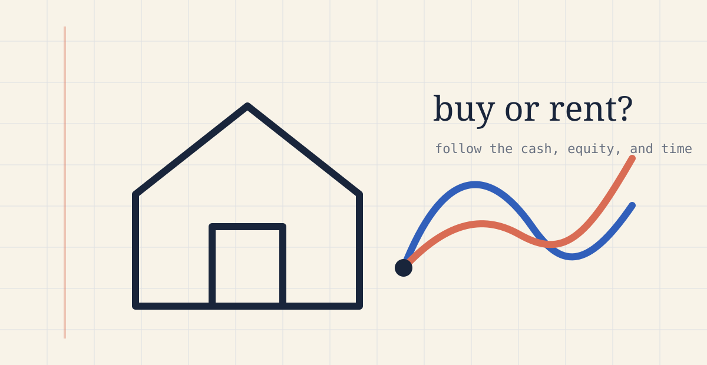

<figure class="housing-hero"></figure>

Buying a home turns cash into a down payment and, over time, mortgage principal into equity. Renting leaves those resources available to invest, but rent can rise and there is no home equity at the end. The comparison depends on more than a mortgage payment. It depends on time, selling costs, maintenance, taxes, investment returns, and whether the household can comfortably fund the path along the way.

The calculator below follows both choices month by month from the same starting resources. It is not a recommendation or a forecast. It is a way to make the assumptions visible and see which ones matter.

<section class="housing-calculator" id="housing-calculator" aria-labelledby="housing-calculator-title">
  <header class="housing-tool-header">

Runs entirely in your browser
<h2 id="housing-calculator-title">Buying versus renting calculator</h2>
Your entries and saved comparisons stay on this device. They are not sent to ritvikmath or placed in the page URL.

<button class="housing-secondary" id="housing-reset" type="button">Reset fictional example</button></header>
  <section class="housing-presets" aria-labelledby="housing-presets-title">

Start with a scenario
<h3 id="housing-presets-title">Choose two profiles</h3>
These fictional starting points are anchored to rounded West Hills-area market and income figures. Pick a home and household profile, then change any field you want.

<label>House profile<select id="housing-house-profile"><option value="lower">Lower-priced home</option><option value="moderate" selected>Moderately priced home</option><option value="higher">Higher-priced home</option><option value="custom">Custom values</option></select></label><label>Financial profile<select id="housing-financial-profile"><option value="lower">Lower income and savings</option><option value="moderate" selected>Moderate income and savings</option><option value="higher">Higher income and savings</option><option value="custom">Custom values</option></select></label></section>
  

Saved comparisons 0

Saved only in this browser. Clearing site data removes them, so download a backup if you need one.

<button type="button" id="housing-undo">Undo delete</button>

  
<strong>Fictional example — replace with your own.</strong> Every prefilled amount below was invented for this public calculator and is not a recommended target or a real household.

  <form id="housing-form">
    <nav class="housing-step-nav" aria-label="Calculator sections"><button type="button" data-step="property" class="active">1. Property</button><button type="button" data-step="household">2. Household</button><button type="button" data-step="assumptions">3. Financing</button></nav>
    <fieldset data-panel="property"><legend>Property</legend>
Enter a hypothetical home or copy the facts from any listing yourself. The calculator does not contact listing websites.

      <label>Comparison name<input id="name" required></label><label>Purchase price ($)<input id="price" type="number" min="10000" step="1000" required></label><label>Current monthly rent ($)<input id="rent" type="number" min="0" step="50" required></label><label>Comparable rent ($, optional)<input id="comparableRent" type="number" min="0" step="50"></label><label>Monthly insurance ($)<input id="insurance" type="number" min="0" step="10" required></label><label>Monthly HOA ($)<input id="hoa" type="number" min="0" step="10" required></label><label>Property tax (% / year)<input id="propertyTax" type="number" min="0" max="10" step="0.01" required></label><label>Maintenance (% / year)<input id="maintenance" type="number" min="0" max="10" step="0.1" required></label><label>Selling costs (% of value)<input id="sellingCost" type="number" min="0" max="20" step="0.1" required></label><label>Utilities difference ($ / month)<input id="utilities" type="number" step="10" required></label>
    
</fieldset>
    <fieldset data-panel="household" hidden><legend>Household finances</legend>

      <label>Take-home income ($ / month)<input id="income" type="number" min="0" step="100" required></label><label>Non-housing expenses ($ / month)<input id="living" type="number" min="0" step="100" required></label><label>Cash ($)<input id="cash" type="number" min="0" step="1000" required></label><label>Taxable investments ($)<input id="taxable" type="number" min="0" step="1000" required></label><label>Taxable cost basis ($)<input id="taxableBasis" type="number" min="0" step="1000" required></label><label>Retirement assets ($)<input id="retirement" type="number" min="0" step="1000" required></label><label>Minimum accessible assets ($)<input id="minimumAccessible" type="number" min="0" step="1000" required></label><label>Minimum monthly surplus ($)<input id="minimumSurplus" type="number" step="50" required></label><label>Reserve target (months)<input id="reserveMonths" type="number" min="0" max="36" step="0.5" required></label><label>Investment sale tax rate (%)<input id="gainTax" type="number" min="0" max="60" step="0.1" required></label><label>Income growth (% / year)<input id="incomeGrowth" type="number" min="-20" max="30" step="0.1" required></label><label>Child or other added cost ($ / month)<input id="childCost" type="number" min="0" step="50" required></label><label>Added cost starts in year<input id="childStart" type="number" min="0" max="50" step="1" required></label><label>Added cost lasts (years)<input id="childYears" type="number" min="0" max="50" step="1" required></label>
    
</fieldset>
    <fieldset data-panel="assumptions" hidden><legend>Financing and assumptions</legend>

      <label>Down payment (%)<input id="downPayment" type="number" min="0" max="100" step="1" required></label><label>Mortgage rate (%)<input id="mortgageRate" type="number" min="0" max="30" step="0.01" required></label><label>Mortgage term (years)<input id="mortgageYears" type="number" min="1" max="50" step="1" required></label><label>Buyer closing costs (%)<input id="closingCosts" type="number" min="0" max="20" step="0.1" required></label><label>Extra principal ($ / month)<input id="extraPrincipal" type="number" min="0" step="50" required></label><label>PMI ($ / month)<input id="pmi" type="number" min="0" step="10" required></label><label>Holding period (years)<input id="horizon" type="number" min="1" max="40" step="1" required></label><label>Forecast length (years)<input id="forecastYears" type="number" min="1" max="40" step="1" required></label><label>Investment return (% / year)<input id="investmentReturn" type="number" min="-20" max="30" step="0.1" required></label><label>Cash return (% / year)<input id="cashReturn" type="number" min="-5" max="20" step="0.1" required></label><label>Inflation (% / year)<input id="inflation" type="number" min="-5" max="20" step="0.1" required></label><label>Rent growth (% / year)<input id="rentGrowth" type="number" min="-10" max="20" step="0.1" required></label><label>Home appreciation (% / year)<input id="appreciation" type="number" min="-20" max="30" step="0.1" required></label><label>Insurance growth (% / year)<input id="insuranceGrowth" type="number" min="-10" max="30" step="0.1" required></label><label>Maintenance growth (% / year)<input id="maintenanceGrowth" type="number" min="-10" max="30" step="0.1" required></label><label>Home gain tax rate (%)<input id="homeGainTax" type="number" min="0" max="60" step="0.1" required></label><label>Home gain exclusion ($)<input id="homeGainExclusion" type="number" min="0" step="1000" required></label><label>One-time repair in year<input id="repairYear" type="number" min="0" max="40" step="1" required></label><label>One-time repair amount ($)<input id="repairAmount" type="number" min="0" step="1000" required></label><label>Tax treatment<select id="taxMode"><option value="none">No incremental tax benefit</option><option value="fixed">Fixed annual estimated benefit</option></select></label><label>Annual tax benefit ($)<input id="annualTaxBenefit" type="number" min="0" step="500" required></label>
    

<strong>Optional public benchmarks</strong>
Manual assumptions are active. No external request has been made.

<button class="housing-secondary" id="housing-live-refresh" type="button">Check latest FRED observations</button>
</fieldset>
    
<button class="housing-primary" type="submit">Run comparison</button><button class="housing-secondary" id="housing-save" type="button">Save this snapshot</button><button class="housing-secondary" id="housing-export" type="button">Download JSON</button><button class="housing-secondary" id="housing-csv" type="button">Download monthly CSV</button>

  </form>
  <section id="housing-results" class="housing-results" hidden aria-live="polite">

Selected horizon
<h3 id="housing-result-title"></h3>

<button type="button" class="active" data-chart="netWorth">Net worth</button><button type="button" data-chart="realNetWorth">Inflation-adjusted</button><button type="button" data-chart="accessible">Accessible assets</button><button type="button" data-chart="equity">Home equity</button><button type="button" data-chart="spending">Monthly spending</button>

<canvas id="housing-chart" aria-label="Interactive buy versus rent comparison chart"></canvas>

<section><h3>By holding period</h3>
<table><thead><tr><th>Year</th><th>Buy net worth</th><th>Rent net worth</th><th>Difference</th></tr></thead><tbody id="housing-periods"></tbody></table>
</section><section><h3>Stress tests</h3>

</section>
<section><h3>What changes the answer?</h3>
Each cell is buying minus renting at the selected horizon.

</section>

Resolved inputs and data sources
<pre id="housing-audit"></pre>
</section>
</section>

## What the model is counting {#method}

The two paths begin with the same cash, taxable investments, retirement assets, income, and non-housing spending. The buying path uses cash and, when necessary, taxable investments for the down payment and closing costs. The renting path leaves that money invested. Retirement assets grow in both paths but are never used to pay monthly bills.

**Cash flow** asks whether income and accessible assets can support each month. A result can look good at year ten while still producing an uncomfortable shortfall in year two, so the calculator reports the minimum monthly surplus and minimum accessible assets separately.

**Equity** is the home's modeled value minus the remaining mortgage. Principal payments move wealth from liquid assets into equity; they are not treated as ordinary consumption. Interest, insurance, taxes, HOA costs, maintenance, and selling costs are expenses.

**Opportunity cost** appears because money used at closing cannot also remain invested. The renting path is credited with investing its available surplus under the same return assumption used for the buyer's remaining investments.

**Holding period** matters because closing and selling costs are front-loaded. A long period gives appreciation and principal repayment more time to compound, while a short period can leave too little time to recover transaction costs.

## Methodology and limitations {#limitations}

The mortgage uses a standard fixed-rate amortization schedule. Property tax can be entered directly; this public version does not claim to reproduce every assessment rule or local exemption. The California-style annual assessment cap in the private research model is deliberately not silently assumed here. Taxes are simplified effective-rate inputs, not tax advice. The home-sale calculation deducts selling costs, the remaining mortgage, and an optional taxable gain after the user-entered exclusion.

The optional FRED button fetches public observations for the 30-year mortgage benchmark, CPI, national rent inflation, the three-month Treasury yield, and the national house-price index. It displays dates and does not apply anything automatically. A national benchmark is not a lender quote, a local rent forecast, an insurance quote, or a prediction. Manual mode remains fully usable if FRED is unavailable.

The preset profiles are fictional conveniences, not financial classifications or recommendations. Their moderate anchors use a rounded recent West Hills median sale price of about $1.0 million from [Redfin](https://www.redfin.com/neighborhood/3006/CA/Los-Angeles/West-Hills/housing-market), a rounded area median rent of about $4,500 from [Realtor.com](https://www.realtor.com/local/market/california/los-angeles/west-hills), and the 2024 ACS median household income of $151,190 for ZIP 91307 reported by [Census Reporter](https://censusreporter.org/profiles/86000US91307-91307/). The monthly take-home amounts are illustrative conversions, not tax estimates.

Property information is manual entry only. The page does not contact, scrape, or transmit information to listing websites.

## A small math zone {#math}

For loan principal $L$, monthly rate $r$, and $n$ payments, the scheduled principal-and-interest payment is

$$
M=L\frac{r(1+r)^n}{(1+r)^n-1}.
$$

At month $t$, the simplified comparison is

$$
\Delta_t=NW_{\text{buy},t}-NW_{\text{rent},t}.
$$

The buying net worth includes cash, investments, retirement assets, and home equity. The renting net worth includes cash, investments, and retirement assets. A second comparison assumes the home is sold at that date:

$$
\Delta_t^{\text{sale}}=A_{\text{buy},t}+P_t-C_t-B_t-T_t-NW_{\text{rent},t},
$$

where $A$ is accessible financial assets, $P$ is the home value, $C$ is selling cost, $B$ is mortgage balance, and $T$ is modeled home-gain tax.

The precision of those equations should not be mistaken for certainty in their inputs. Appreciation, rent growth, investment returns, repairs, taxes, and the eventual selling date are unknown. The sensitivity table is therefore as important as the headline result.

<link rel="stylesheet" href="{{ site.baseurl }}/assets/housing-calculator.css?v=20261108-5">

