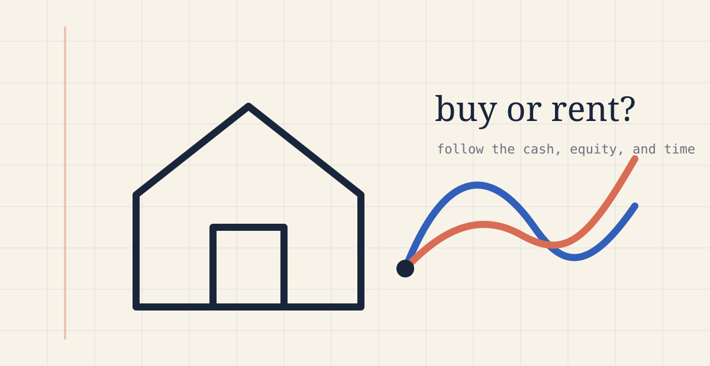

<figure class="housing-hero"></figure>

Buying a home turns cash into a down payment and, over time, mortgage principal into equity. Renting leaves those resources available to invest, but rent can rise and there is no home equity at the end. The comparison depends on more than a mortgage payment. It depends on time, selling costs, maintenance, taxes, investment returns, and whether the household can comfortably fund the path along the way.

The calculator below follows both choices month by month from the same starting resources. It is not a recommendation or a forecast. It is a way to make the assumptions visible and see which ones matter.

<section class="housing-calculator" id="housing-calculator" aria-labelledby="housing-calculator-title">
  <header class="housing-tool-header">

Runs entirely in your browser
<h2 id="housing-calculator-title">Buying versus renting calculator</h2>
Your entries and saved comparisons stay on this device. They are not sent to ritvikmath or placed in the page URL.

<button class="housing-secondary" id="housing-reset" type="button">Reset fictional example</button></header>
  <section class="housing-presets" aria-labelledby="housing-presets-title">

Start with a scenario
<h3 id="housing-presets-title">Choose two profiles</h3>
These independently invented starting points use rounded West Hills-area reference figures. Change any field.

<label>House profile<select id="housing-house-profile"><option value="lower">Lower-priced home</option><option value="moderate" selected>Moderately priced home</option><option value="higher">Higher-priced home</option><option value="custom">Custom values</option></select></label><label>Financial profile<select id="housing-financial-profile"><option value="lower">Lower income and savings</option><option value="moderate" selected>Moderate income and savings</option><option value="higher">Higher income and savings</option><option value="custom">Custom values</option></select></label></section>
  

Saved comparisons 0

Saved only in this browser. Old saves are migrated once to automatic closing costs and recalculated without refreshing live rates.

<button type="button" id="housing-undo">Undo delete</button>

  
<strong>Fictional example — replace with your own.</strong> Every prefilled amount was independently invented for this public calculator.

  <form id="housing-form">
    <nav class="housing-step-nav" aria-label="Calculator sections"><button type="button" data-step="property" class="active">1. Property</button><button type="button" data-step="household">2. Household</button><button type="button" data-step="financing">3. Financing</button></nav>
    <fieldset data-panel="property"><legend>Property</legend>
Manual entry only. Verify insurance, property tax, HOA, special assessments, and repairs for the actual property.

      <label>Comparison name<input id="name" required></label><label>Purchase price ($)<input id="price" type="number" min="10000" step="1000" required></label><label>Current monthly rent ($)<input id="rent" type="number" min="0" step="50" required></label><label>Comparable rent ($)<input id="comparableRent" type="number" min="0" step="50" required></label><label>Jurisdiction<select id="jurisdiction"><option value="CA">California</option><option value="other">Other—verify taxes</option></select></label><label>Monthly insurance ($)<input id="insurance" type="number" min="0" step="10" required></label><label>Monthly HOA ($)<input id="hoa" type="number" min="0" step="10" required></label><label>Property tax (% / year)<input id="propertyTax" type="number" min="0" max="10" step="0.01" required></label><label>Maintenance (% / year)<input id="maintenance" type="number" min="0" max="10" step="0.1" required></label><label>Selling costs (% of value)<input id="sellingCost" type="number" min="0" max="20" step="0.1" required></label><label>Utilities difference ($ / month)<input id="utilities" type="number" step="10" required></label>
    
</fieldset>
    <fieldset data-panel="household" hidden><legend>Household finances</legend>

      <label>Take-home income ($ / month)<input id="income" type="number" min="0" step="100" required></label><label>Non-housing expenses ($ / month)<input id="living" type="number" min="0" step="100" required></label><label>Cash ($)<input id="cash" type="number" min="0" step="1000" required></label><label>Taxable investments ($)<input id="taxable" type="number" min="0" step="1000" required></label>
      <label>Brokerage cost basis <button class="help-button" type="button" aria-expanded="false" aria-controls="help-basis">?</button>The amount originally paid for taxable investments, adjusted for later purchases and sales. It helps estimate tax when investments are sold.<input id="taxableBasis" type="number" min="0" step="1000" required></label>
      <label>Retirement assets ($)<input id="retirement" type="number" min="0" step="1000" required></label>
      <label>Minimum accessible assets <button class="help-button" type="button" aria-expanded="false" aria-controls="help-accessible">?</button>Your chosen floor for cash plus after-tax taxable investments. Retirement accounts and home equity are excluded.<input id="minimumAccessible" type="number" min="0" step="1000" required></label>
      <label>Minimum monthly surplus <button class="help-button" type="button" aria-expanded="false" aria-controls="help-surplus">?</button>A budget threshold, not another expense. Results compare it with the worst single modeled month before investment returns and ownership tax benefits.<input id="minimumSurplus" type="number" step="50" required></label>
      <label>Cash reserve target (months) <button class="help-button" type="button" aria-expanded="false" aria-controls="help-reserve">?</button>How many months of current modeled spending the calculator attempts to keep in cash before investing excess cash.<input id="reserveMonths" type="number" min="0" max="36" step="0.5" required></label>
      <label>Investment sale tax rate (%)<input id="gainTax" type="number" min="0" max="60" step="0.1" required></label><label>Income growth (% / year)<input id="incomeGrowth" type="number" min="-20" max="30" step="0.1" required></label><label>Retirement month (-1 = unset) <button class="help-button" type="button" aria-expanded="false" aria-controls="help-retirement">?</button>Month zero is the purchase month. If unset, working income continues through the forecast.<input id="retirementMonth" type="number" min="-1" max="480" step="1" required></label><label>Retirement take-home ($ / month)<input id="retirementIncome" type="number" min="0" step="100" required></label><label>Retirement return (% / year)<input id="retirementReturn" type="number" min="-20" max="30" step="0.1" required></label><label>Taxable distribution yield (%) <button class="help-button" type="button" aria-expanded="false" aria-controls="help-distributions">?</button>Cash distributions from taxable investments. Their tax drag is modeled separately from price appreciation.<input id="distributionYield" type="number" min="0" max="30" step="0.1" required></label><label>Distribution tax rate (%)<input id="distributionTax" type="number" min="0" max="60" step="0.1" required></label>
    
<section class="dependent-costs"><h3>Dependent-cost phases</h3>
Start month is included; end month is excluded. Amounts are start-date dollars and rise with inflation. Phases cannot overlap.

<button class="housing-secondary" id="add-dependent-phase" type="button">Add phase</button></section></fieldset>
    <fieldset data-panel="financing" hidden><legend>Mortgage &amp; assumptions</legend>
Start with the few choices that drive the financing. Advanced settings remain available below.

      <label>Expected years in the home<input id="horizon" type="number" min="1" max="40" step="1" required></label><label>Down payment (%)<input id="downPayment" type="number" min="0" max="100" step="1" required></label><label>Mortgage-rate source<select id="mortgageSource"><option value="benchmark">Automatic — latest validated FRED benchmark</option><option value="manual">Manual quote</option></select></label><label id="manual-rate-wrap">Manual mortgage rate (%)<input id="mortgageRate" type="number" min="0" max="30" step="0.01" required></label>
    

    

Closing costs &amp; credits

Automatic mode uses a 3.5% planning midpoint within CFPB’s broad 2–5% range. It is not a measured local average or lender quote. One point is 1% of the financed amount.

<label>Closing-cost mode<select id="closingMode"><option value="auto">Automatic planning estimate</option><option value="manual">Manual verified amount</option></select></label><label>Closing budget (% of price)<input id="closingFraction" type="number" min="0" max="20" step="0.1"></label><label>Additional discount points (%)<input id="closingPoints" type="number" min="0" max="10" step="0.1"></label><label>Confirmed credits ($)<input id="closingCredits" type="number" min="0" step="100"></label><label>Escrow deposit ($) <button class="help-button" type="button" aria-expanded="false" aria-controls="help-prepaids">?</button>Escrow and prepaids are separately tracked assets or prepaid expenses, not all true transaction fees. Unitemized prepaids inside the broad budget are conservatively expensed.<input id="escrowDeposit" type="number" min="0" step="100"></label><label>Prepaid insurance ($)<input id="prepaidInsurance" type="number" min="0" step="100"></label><label>Prepaid property tax ($)<input id="prepaidPropertyTax" type="number" min="0" step="100"></label><label id="manual-closing-wrap">Manual transaction fees ($)<input id="manualClosingCosts" type="number" min="0" step="100"></label><label>Moving costs ($)<input id="movingCosts" type="number" min="0" step="100"></label>

    

Growth assumptions &amp; market data

<label>Forecast length (years)<input id="forecastYears" type="number" min="1" max="40" step="1"></label><label>Budget-check window (years) <button class="help-button" type="button" aria-expanded="false" aria-controls="help-window">?</button>Capped to the forecast and separate from the holding period. Continuing beyond the holding period is a stress projection, not a modeled sale and reinvestment.<input id="affordabilityYears" type="number" min="1" max="40" step="1"></label><label>Start / purchase month<input id="startMonth" type="month"></label><label>Investment return (%)<input id="investmentReturn" type="number" step="0.1"></label><label>Cash return (%)<input id="cashReturn" type="number" step="0.1"></label><label>Inflation (%)<input id="inflation" type="number" step="0.1"></label><label>Rent growth (%)<input id="rentGrowth" type="number" step="0.1"></label><label>Home appreciation (%)<input id="appreciation" type="number" step="0.1"></label><label>Insurance growth (%)<input id="insuranceGrowth" type="number" step="0.1"></label><label>Maintenance growth (%)<input id="maintenanceGrowth" type="number" step="0.1"></label><label>HOA growth (%)<input id="hoaGrowth" type="number" step="0.1"></label><label>Effective tax on Treasury yield (%)<input id="cashTaxRate" type="number" min="0" max="100" step="1"></label>

<label><input id="applyInflation" type="checkbox"> Apply current inflation reading</label><label><input id="applyRent" type="checkbox"> Apply current national rent reading</label><label><input id="applyHome" type="checkbox"> Apply current national home-price reading</label><label><input id="applyCash" type="checkbox"> Apply after-tax Treasury yield</label>

<strong>Optional public benchmarks</strong>
Manual planning assumptions are active. Current observations are reference-only unless you opt in.

<button class="housing-secondary" id="housing-live-refresh" type="button">Check validated FRED observations</button>

    

Taxes, refinancing &amp; other settings

<label>Mortgage term (years)<input id="mortgageYears" type="number" min="1" max="50" step="1"></label><label>Extra principal ($ / month)<input id="extraPrincipal" type="number" min="0" step="50"></label><label>PMI ($ / month)<input id="pmi" type="number" min="0" step="10"></label><label>Home gain tax rate (%)<input id="homeGainTax" type="number" min="0" max="60" step="0.1"></label><label>Home gain exclusion ($)<input id="homeGainExclusion" type="number" min="0" step="1000"></label><label class="check-label"><input id="homeGainEligible" type="checkbox"> Assume home-sale exclusion eligibility</label><label>One-time repair in year<input id="repairYear" type="number" min="0" max="40" step="1"></label><label>One-time repair amount ($)<input id="repairAmount" type="number" min="0" step="1000"></label><label>Ownership tax treatment <button class="help-button" type="button" aria-expanded="false" aria-controls="help-tax">?</button>The approximate method compares published standard deductions with simplified mortgage-interest and SALT itemization. It is not a complete tax return.<select id="taxMode"><option value="none">No incremental tax benefit</option><option value="approx">Approximate federal method</option><option value="fixed">Professional/user override</option></select></label><label id="fixed-tax-wrap">Annual override ($)<input id="annualTaxBenefit" type="number" min="0" step="500"></label><label data-tax-approx>Filing status<select id="filingStatus"><option value="mfj">Married filing jointly</option><option value="single">Single</option></select></label><label data-tax-approx>MAGI ($ / year)<input id="magiAnnual" type="number" min="0" step="1000"></label><label data-tax-approx>Federal marginal rate (%)<input id="federalMarginalRate" type="number" min="0" max="37" step="0.1"></label><label data-tax-approx>Other SALT ($ / year)<input id="otherSaltAnnual" type="number" min="0" step="100"></label><label data-tax-approx>Other itemized deductions ($ / year)<input id="otherItemizedAnnual" type="number" min="0" step="100"></label><label data-tax-approx>State incremental benefit ($ / year)<input id="stateTaxBenefit" type="number" step="100"></label>

    </fieldset>
    
<button class="housing-primary" type="submit">Run comparison</button><button class="housing-secondary" id="housing-save" type="button">Save this snapshot</button><button class="housing-secondary" id="housing-export" type="button">Download JSON</button><button class="housing-secondary" id="housing-csv" type="button">Download monthly CSV</button>

  </form>
  <section id="housing-results" class="housing-results" hidden aria-live="polite">

Selected horizon
<h3 id="housing-result-title"></h3>

<section id="housing-worst-month" class="housing-worst-month"></section>

<button type="button" class="active" data-chart="netWorth">Net worth</button><button type="button" data-chart="realNetWorth">Inflation-adjusted</button><button type="button" data-chart="accessible">Accessible assets</button><button type="button" data-chart="equity">Home equity</button><button type="button" data-chart="spending">Monthly spending</button>

<canvas id="housing-chart" aria-label="Interactive buy versus rent comparison chart"></canvas>

<section><h3>By holding period</h3>
<table><thead><tr><th>Year</th><th>Buy net worth</th><th>Rent net worth</th><th>Difference</th></tr></thead><tbody id="housing-periods"></tbody></table>
</section><section><h3>Stress tests</h3>

</section>
<section><h3>What changes the answer?</h3>
Each cell is buying minus renting at the selected horizon.

</section>

Defaults review and data sources

</section>
</section>

## What the model is counting {#method}

The two paths begin with the same cash, taxable investments, retirement assets, income, and non-housing spending. The buying path uses cash and, when necessary, taxable investments for the down payment and closing costs. The renting path leaves that money invested. Retirement assets grow in both paths but are never used to pay monthly bills.

**Cash flow** asks whether income and accessible assets can support each month. A result can look good at year ten while still producing an uncomfortable shortfall in year two, so the calculator reports the minimum monthly surplus and minimum accessible assets separately.

**Equity** is the home's modeled value minus the remaining mortgage. Principal payments move wealth from liquid assets into equity; they are not treated as ordinary consumption. Interest, insurance, taxes, HOA costs, maintenance, and selling costs are expenses.

**Opportunity cost** appears because money used at closing cannot also remain invested. The renting path is credited with investing its available surplus under the same return assumption used for the buyer's remaining investments.

**Holding period** matters because closing and selling costs are front-loaded. A long period gives appreciation and principal repayment more time to compound, while a short period can leave too little time to recover transaction costs.

## Methodology and limitations {#limitations}

The mortgage is a plain fixed-rate amortizing loan with no hidden temporary buydown. Automatic closing costs begin with 3.5% of purchase price—the midpoint of the [CFPB's broad 2–5% planning range](https://www.consumerfinance.gov/owning-a-home/prepare/determine-your-down-payment/)—then add explicit discount points and subtract confirmed credits and separately entered escrow or prepaids. The midpoint is a planning judgment, not a local average or quote. Down payment and moving costs remain separate. Unitemized prepaids inside the broad budget are conservatively expensed until allocated.

Property tax is entered directly; this public version does not claim to reproduce every assessment rule or local exemption. The default is explicitly California-oriented and must be replaced elsewhere. The optional approximate federal tax method compares mortgage interest and SALT-limited property taxes with the published standard deduction. The calculator uses the IRS's [2026](https://www.irs.gov/publications/p505) amounts of 32,200 dollars for married filing jointly and 16,100 dollars for single filers, and the [2027](https://www.irs.gov/newsroom/irs-releases-tax-inflation-adjustments-for-tax-year-2027-taxpayers-continue-to-benefit-from-the-working-families-tax-cuts) amounts of 33,200 and 16,600 dollars; later amounts are labeled projections. The method is not a complete tax return, and no ownership benefit is credited by default. The home-sale calculation deducts selling costs, the remaining mortgage, and a user-selected taxable gain after the entered exclusion. A holding period alone does not establish exclusion eligibility.

The optional FRED button fetches public observations for the 30-year mortgage benchmark, CPI, national rent inflation, the three-month Treasury yield, and the national house-price index. Year-over-year figures require an exact year-earlier observation, and stale observations are rejected. Current economic readings remain reference-only unless the user explicitly opts in. Applying one holds that reading constant as a scenario, not a forecast. A weekly mortgage benchmark is not a same-day personal lender quote. Manual mode remains fully usable when reference-only data is unavailable; data chosen for calculations must validate successfully.

The preset profiles are fictional conveniences, not financial classifications or recommendations. Their moderate anchors use a rounded recent West Hills median sale price of about $1.0 million from [Redfin](https://www.redfin.com/neighborhood/3006/CA/Los-Angeles/West-Hills/housing-market), a rounded area median rent of about $4,500 from [Realtor.com](https://www.realtor.com/local/market/california/los-angeles/west-hills), and the 2024 ACS median household income of $151,190 for ZIP 91307 reported by [Census Reporter](https://censusreporter.org/profiles/86000US91307-91307/). The monthly take-home amounts are illustrative conversions, not tax estimates.

Property information is manual entry only. The page does not contact, scrape, or transmit information to listing websites.

## A small math zone {#math}

For loan principal $L$, monthly rate $r$, and $n$ payments, the scheduled principal-and-interest payment is

$$
M=L\frac{r(1+r)^n}{(1+r)^n-1}.
$$

At month $t$, the simplified comparison is

$$
\Delta_t=NW_{\text{buy},t}-NW_{\text{rent},t}.
$$

The buying net worth includes cash, investments, retirement assets, and home equity. The renting net worth includes cash, investments, and retirement assets. A second comparison assumes the home is sold at that date:

$$
\Delta_t^{\text{sale}}=A_{\text{buy},t}+P_t-C_t-B_t-T_t-NW_{\text{rent},t},
$$

where $A$ is accessible financial assets, $P$ is the home value, $C$ is selling cost, $B$ is mortgage balance, and $T$ is modeled home-gain tax.

The precision of those equations should not be mistaken for certainty in their inputs. Appreciation, rent growth, investment returns, repairs, taxes, and the eventual selling date are unknown. The sensitivity table is therefore as important as the headline result.

<link rel="stylesheet" href="{{ site.baseurl }}/assets/housing-calculator.css?v=20261119-2">

